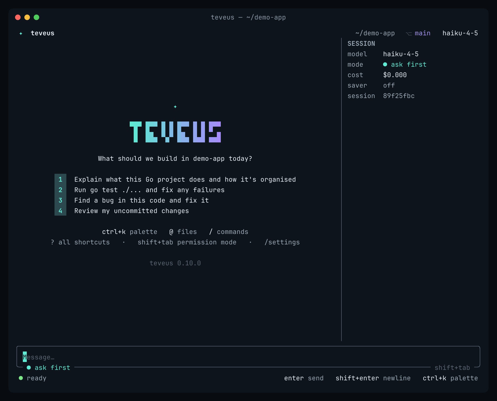
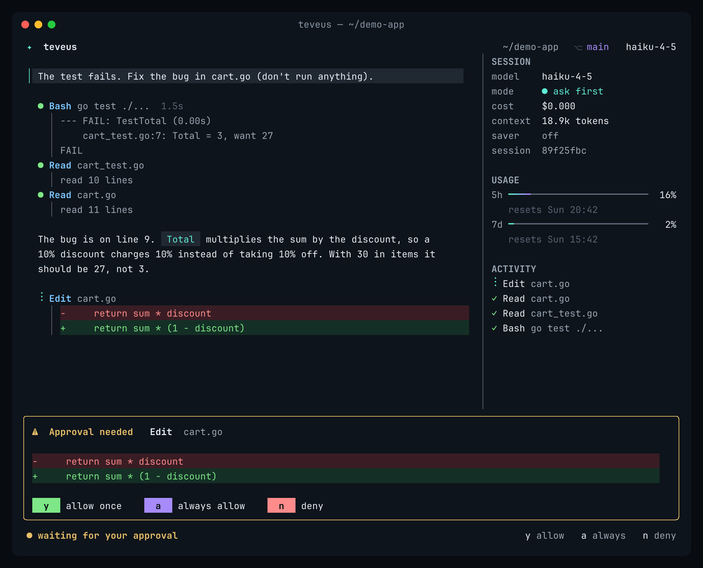
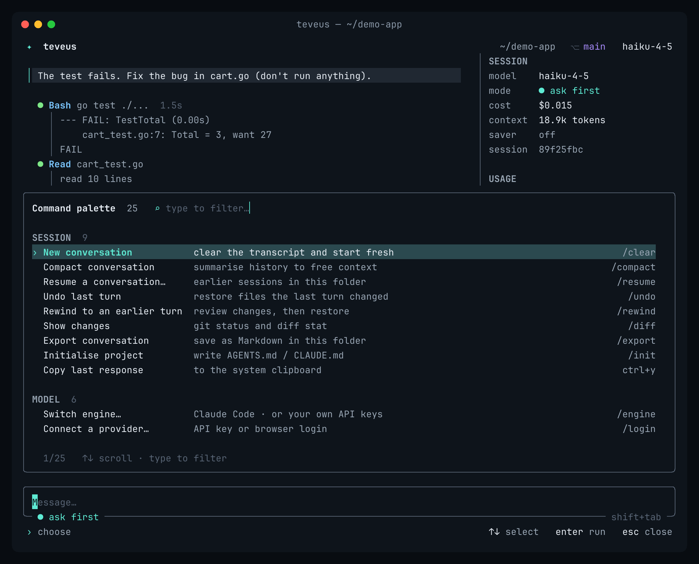
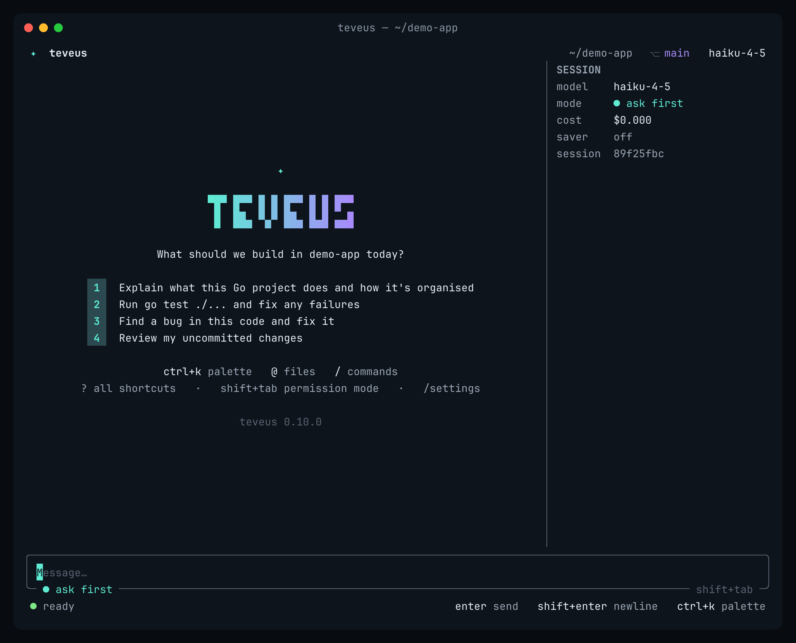
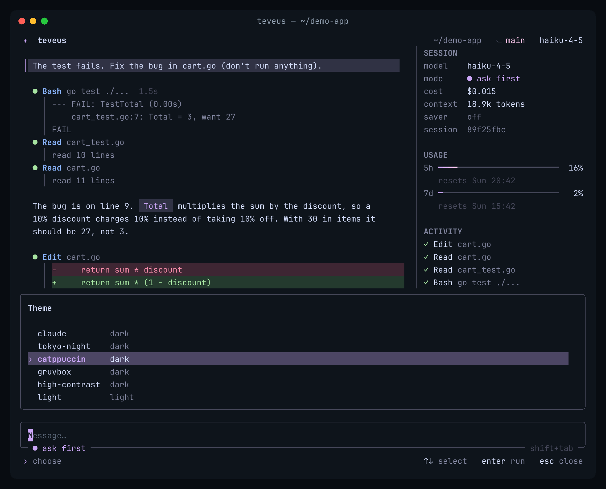

<div align="center">

# teveus

**A free, open-source AI coding assistant for your terminal.**
Run Claude Code, Google Antigravity CLI (`agy`), or any AI provider with your own key in one fast, clean terminal UI.

[Website](https://www.teveus.xyz) · [Docs](https://www.teveus.xyz/docs) · [Releases](https://www.teveus.xyz/releases)



</div>

## Install

**macOS and Linux**

```sh
curl -fsSL https://raw.githubusercontent.com/stawan15/teveus/main/install.sh | sh
```

**Windows (PowerShell)**

```powershell
irm https://raw.githubusercontent.com/stawan15/teveus/main/install.ps1 | iex
```

Works on macOS, Linux, and 64-bit Windows. Run the same installer again to update.

> **Using a Claude or Google Antigravity subscription?**
> Install [Claude Code](https://claude.com/claude-code) or Google Antigravity CLI (`agy`) and sign in through the provider's own login. teveus runs your installed CLI as-is and never sees your credentials.
> For OpenAI, Gemini API, OpenRouter, and local models, you don't need any external CLI.

## Get started

1. Open a terminal in your project folder.
2. Run `teveus`, then connect an AI with `/login` (Claude Code, `agy`, or an API key). Nothing is connected until you choose.
3. Type what you want in plain language (for example, *"find the bug in the login page and fix it"*) and press **enter**.

teveus shows every file edit and command **before** it runs. Press **y** to allow or **n** to deny.

On first launch, a 3-step setup lets you choose your guidance level, colour theme, and AI connection.

## Screenshots

| Approve changes before they happen | Every action one search away |
|:---:|:---:|
|  |  |
| **Welcome screen with starter ideas** | **Live theme preview** |
|  |  |

## Features

### AI and engines
- **Use any provider:** Claude Code, Google Antigravity CLI (`agy`), OpenAI, Anthropic API, Gemini, OpenRouter (including free models), Groq, DeepSeek, xAI, Mistral, OpenCode (Go or Console), or local models (Ollama, LM Studio).
- **Switch mid-session:** Run `/engine` to switch between `claude`, `antigravity`, and `api` without losing your transcript.
- **Images and long pastes:** Drop a screenshot into the terminal or press `ctrl+v` to paste an image. Long pastes fold cleanly into `[Pasted text #1 +40 lines]`.

### Safety and control
- **Diffs before edits:** Review every change as a coloured diff and approve or deny it first.
- **Permission rules (Direct API):** Save per-project rules like "always allow `go test`" and manage them with `/permissions`.
- **Undo and rewind:** `/undo` reverts the last file change; `/rewind` previews diffs and restores any earlier turn.
- **Sessions and worktrees:** Run parallel conversations with `/sessions` (`alt+1` to `alt+9`), or isolate a session in its own git worktree with `/worktree`.

### Tools and customization
- **Web, MCP, and sub-agents (Direct API):** Fetch web pages, search the web (Brave or Tavily key), connect `.mcp.json` servers, and run parallel research sub-agents. (Claude Code brings its own.)
- **Commands, skills, and hooks:** Load custom slash commands and [Agent Skills](https://agentskills.io) from `.teveus/commands` and `.teveus/skills` (`.agent`, `.agents`, and `.claude` directories are also supported). Use `/hooks` to run shell commands before or after tool calls.
- **Search and resume:** `/resume` reopens past sessions; `/search text` searches across your current and previous conversations.
- **Themes and layout:** 7 themes (`minimal`, `claude`, `tokyo-night`, `catppuccin`, `gruvbox`, `high-contrast`, `light`), 3 guidance levels, and a reduce-motion option.

### Token and cost savers
- **Presets and toggles:** Off by default. Enable `/saver` (`full`, `balanced`, `max`), `/concise` for short replies, `/lean` to trim tool definitions (Claude Code and Direct API), and `/minimal` to keep edits focused.
- **Trim unused code:** `/trim` reviews uncommitted changes for unnecessary code; `/trim all` checks the whole project.
- **Lean long sessions (Direct API):** Old tool output is replaced with a one-line note, unchanged files are not re-sent, and `/subagent` can offload research to a cheaper model.

## Keys to know

You only need the first three. Press **`?`** inside teveus to see all shortcuts.

| Key | Action |
|---|---|
| `enter` | Send message |
| `shift+enter` | New line (or `ctrl+j`, or `\` then `enter`) |
| `ctrl+k` | Open command palette |
| `?` | Show all shortcuts |
| `shift+tab` | Cycle mode: **ask first** -> **auto-edit** -> **plan only** -> **autopilot** |
| `@` | Attach a file by name |
| `ctrl+v` | Paste an image from clipboard |
| `esc` `esc` | Stop the current task |
| Mouse drag | Select and copy text |
| `ctrl+c` `ctrl+c` | Quit |

## Commands

Type `/` to browse commands, or keep typing to filter.

| Command | Action |
|---|---|
| `/login` | Sign in to Claude Code, `agy`, or connect an API provider |
| `/engine` | Switch engine (`claude`, `antigravity`, `api`) mid-session |
| `/model` | Switch model (search by name or type `free`; flows into `/effort` on `agy`) |
| `/effort` | Adjust reasoning effort (auto, low, up to max) |
| `/undo` | Undo the last file change |
| `/rewind` | Preview and restore an earlier turn |
| `/sessions` | Manage multiple conversations (`alt+1` to `alt+9` to switch) |
| `/resume` | Reopen an earlier conversation |
| `/search` | Search text across current and past conversations |
| `/worktree` | Start a session in its own git worktree |
| `/hooks` | Configure commands that run around tool calls |
| `/diff` | View current changes |
| `/commit` | Stage, generate a message, and commit (`/commit only the parser` to steer) |
| `/init` | Generate project notes to give the AI better context |
| `/settings` | Open preferences |
| `/mcp` | Manage MCP servers (toggle on/off, OAuth sign-in, approve `.mcp.json`, add/retry) |
| `/permissions` | Manage saved tool allow/deny rules |
| `/phone` | Start, stop, or view the link for the phone web UI |
| `/update` | Check for and install updates |
| `!command` | Run a shell command directly (e.g. `!npm test`) |

## Remote control from your phone

Run `/phone` to start a lightweight local web page served by teveus so you can monitor and approve tasks away from your desk.

- **Prompt, watch, approve:** Send messages, read replies, approve or deny tool calls, and stop a running turn.
- **All open windows:** Every running teveus terminal appears on the page.
- **Slash commands:** Type `/` on the phone page to search and run app commands.
- **Off by default:** Starts only when you run `/phone` or enable it in `/settings`, and stops when you turn it off or quit.
- **Persistent link:** Reuses the same link across runs so you can bookmark it. Delete `~/.config/teveus/phone-token` to revoke the old link and generate a new one. Opening the link exchanges the token for a cookie so it isn't kept in the URL bar.
- **Safer by design:** The phone UI can switch to plan mode or ask-before-edits, but cannot enable autopilot, grant "always allow", trust a folder, or accept the Claude Code notice.

By default it listens on `127.0.0.1:8787`, which you can reach over [Tailscale](https://tailscale.com), `ssh -L`, or a TLS reverse proxy. You can bind to your network with `teveus -phone 0.0.0.0:8787` (teveus warns that this serves plain HTTP on your network). Keep the link on a trusted network; nothing leaves your machine except the prompts you send.

## Connect other AI providers

Run `/login` inside teveus and choose:

- **OpenRouter:** Browser OAuth login with no key to copy. Hundreds of models; type `free` in `/model` to filter free ones.
- **OpenAI, Anthropic, Gemini, Groq, DeepSeek, xAI, Mistral, OpenCode:** Paste an API key (verified before saving and stored locally). For OpenCode, choose Go (subscription) or Console (pay-as-you-go).
- **Ollama or LM Studio:** Works automatically when running locally.

## Scripting and CLI

Run a single prompt without the interactive UI:

```sh
teveus -p "your prompt"
teveus -p "your prompt" -json   # include cost and token counts
```

Tools requiring approval are denied in headless mode unless you pass `-mode acceptEdits` or `-mode auto`.

Manage MCP servers from the command line (using the same format as Claude Code):

```sh
teveus mcp add --transport http --scope user pastel https://host/api/mcp
teveus mcp add --scope project notes npx -y @modelcontextprotocol/server-filesystem ~/notes
teveus mcp list
teveus mcp enable pastel
teveus mcp disable pastel
teveus mcp remove --scope user pastel
```

## FAQ

<details>
<summary><b>Do I use my Claude plan, or pay per token?</b></summary>

With the **Claude Code** engine, teveus runs your installed Claude Code CLI, which uses whatever you signed in with (your Claude plan or an API key).
teveus never reads, stores, or transmits your Claude login, and asks once for confirmation before launching `claude`.
With **Direct API** (`/engine api`), you pay your chosen provider per token using your own API key.
</details>

<details>
<summary><b>Is teveus made by Anthropic?</b></summary>

No. teveus is an independent open-source project and is not affiliated with, endorsed by, or supported by Anthropic.
</details>

<details>
<summary><b>How do I select and copy text?</b></summary>

Drag with the mouse to select text; it copies automatically on release. Double-click selects a word and triple-click selects a line.
Press `ctrl+y` to copy the entire last reply, or run `/mouse` to use your terminal's native selection.
</details>

<details>
<summary><b>Where are my settings and keys stored?</b></summary>

In `~/.config/teveus/`. API keys are stored in `auth.json` with `0600` permissions (readable only by you).
</details>

<details>
<summary><b>How do I uninstall?</b></summary>

**macOS and Linux**

```sh
rm ~/.local/bin/teveus
rm -rf ~/.config/teveus   # also removes settings and saved keys
```

**Windows (PowerShell)**

```powershell
Remove-Item -Recurse "$env:LOCALAPPDATA\Programs\teveus"
Remove-Item -Recurse "$env:APPDATA\teveus"   # also removes settings and saved keys
```
</details>

## More ways to install

- **Go:** `go install github.com/stawan15/teveus@latest`
- **Manual download:** Download an archive from [Releases](https://github.com/stawan15/teveus/releases)
- **Installer options:** Set `TEVEUS_INSTALL_DIR` or `TEVEUS_VERSION=v0.10.0` before running the installer

## Development

```sh
go build -o teveus . && ./teveus   # build and run from source
go test ./...                       # run tests
docs/record.sh                      # re-record the demo GIF and screenshots
```

Built with [Bubble Tea](https://github.com/charmbracelet/bubbletea), [Lip Gloss](https://github.com/charmbracelet/lipgloss), and [Glamour](https://github.com/charmbracelet/glamour).
See [CLAUDE.md](CLAUDE.md) for codebase architecture and contributor guidelines.

## Privacy and security

teveus collects no telemetry and runs no backend servers: your prompts go only to the AI provider you selected.
See [PRIVACY.md](PRIVACY.md) for what is sent and stored locally, and [SECURITY.md](SECURITY.md) for safeguards and vulnerability reporting.

## Changelog

See [CHANGELOG.md](CHANGELOG.md) for release notes.

## Legal

- teveus is an independent project, not affiliated with, endorsed by, or sponsored by Anthropic PBC or any other AI provider. Claude, Claude Code, and Anthropic are trademarks of Anthropic PBC; other names belong to their respective owners and are used only to describe compatibility.
- Your use of Claude Code and Claude is governed by Anthropic's [Consumer Terms](https://www.anthropic.com/legal/consumer-terms) or [Commercial Terms](https://www.anthropic.com/legal/commercial-terms) and [Usage Policy](https://www.anthropic.com/legal/aup), and other providers' services by their own terms. teveus does not resell, pay for, or route anyone's AI usage; each user supplies their own account or key.
- AI agents can edit and delete files and run commands. Review what you approve and keep your work in version control. teveus is provided "as is", without warranty of any kind, and the authors are not liable for any damage, loss, or cost from using it; see the [license](LICENSE).

## License

[MIT](LICENSE)
